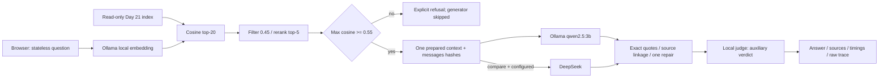

# День 28 — локальная LLM + RAG

Логи, скриншоты, видео и сырые результаты прогонов удалены из репозитория.
Каталог `artifacts/` создаётся локально при запуске проверок и исключён из Git.
Исходники, тесты, входные наборы и конфигурации сохранены для воспроизведения.
Упоминания результатов прежних прогонов ниже описывают исторические измерения;
для просмотра файлов отчётов и сохранённых таблиц UI выполните соответствующие проверки заново.

Рабочий browser RAG над индексом Недели 6. Пользовательский вопрос проходит через настоящий Ollama embedding, локальный поиск и reranking, relevance gate, локальную qwen2.5:3b, проверку точных цитат и локальный judge. Ответ, источники, причина отказа и измерения доступны в интерфейсе.

Дни 21–25 уже использовали локальные модели. День 28 добавляет интеграцию в самостоятельный интерфейс, общий retrieval для сравнения генераторов, сохранение исходных API результатов, фиксированный benchmark и эксперимент с запретом внешних подключений. Предыдущие дни не изменены.

## Запуск

Нужны Go 1.26 и уже установленные модели Ollama. Для подготовки при наличии интернета:

```bash
ollama pull qwen3-embedding:0.6b
ollama pull qwen2.5:3b
ollama serve # только если сервер ещё не работает
```

Из корня проекта:

```bash
cd /Users/romansurzhan/ai_challenge/day-28
./run-web.sh
```

Открыть <http://127.0.0.1:8088>. Скрипт запускает один Go backend, не управляет чужими процессами. Все CSS/JS встроены в бинарник; CDN и внешние шрифты отсутствуют. Запуск без облачного ключа поддерживается по умолчанию.

```bash
./run-web.sh --addr 127.0.0.1:8088 --model qwen2.5:3b
# после сборки не нужен Go runtime:
go build -o rag-web ./cmd/rag-web
./rag-web
```

Опциональное сравнение с прежним DeepSeek:

```bash
./run-web.sh --cloud
# другой server-side dotenv:
./run-web.sh --cloud --cloud-env-file /absolute/path/to/private.env
```

Только `--cloud` читает `../.env` или окружение с DEEPSEEK_API_KEY / DEEPSEEK_MODEL / DEEPSEEK_BASE_URL. Секрет не включается в API responses, logs, prompts или browser assets. Default — cloud disabled; с флагом, но без ключа — not_configured. Режим сравнения сообщает о пропуске облака и выполняет локальный запрос. Ошибка облачного API остаётся ошибкой отдельной ветки; замены облака локальной моделью нет.

В этой сессии отправка корпуса в DeepSeek заблокирована автоматической проверкой до отдельного разрешения. Реальное облачное сравнение не выполнено; адаптер реализован, но его реальный cloud API не проверен. Использовать `--cloud` и сравнение следует при разрешённой отправке контекста этому провайдеру.

## Архитектура



Код компонент перенесён из `day-24/internal` в собственный Go-модуль `ai-challenge/day-28`, как это было сделано в Дне 25: ограничения Go internal не обходятся. Переиспользованы indexstore, embedding, retrieval, reranking, generation settings, agent, evidence, judging, rewriting. Rewrite существует в коде, но отключён. Пакеты `experiment` и `cmd/rag-web` добавляют общий prepared retrieval, API adapters, измерения, HTTP и benchmark. Второго RAG/стека нет; фронтенд — обычный HTML/CSS/JS.

Индекс `../day-21/artifacts/index-structural.json`: только day-16–day-20; corpus ID `b7d4f83675e1fc7c8d1c112bee933610e15ecd5aa5ade9e6d30a7bbc070cc451`; 106 документов / 1025 chunks; embedding qwen3-embedding:0.6b / 1024. Индекс не перестраивался. SHA-256 до/после: `febe8a3348d90d2d68b6a09073936d3999864049b1224b83f5bd722614d2cbad`.

Сохранены candidate-K=20, final-K=5, chunk cosine=0.45, answer gate=0.55, reranker 0.70/0.20/0.10, quote 20–160 runes, generation 512 tokens, judge 128 tokens, temperature=0, явное окно Ollama num_ctx=32768 для generation/judge. Ни prompt, ни пороги не ветвятся по демонстрационным вопросам.

Stateless означает, что follow-up не видит предыдущий вопрос. Выбран для сравнения генераторов: history, resolver, memory, rewrite не выполняются. Для многоходового режима остаётся приложение Дня 25.

Один контекст и его порядок передаются обоим генераторам. Common messages hash относится к первому запросу; repair-вызовы могут различаться, хранят отдельные hashes. Local использует исходную constrained JSON Schema, DeepSeek — json_object, по [документации провайдера](https://api-docs.deepseek.com/guides/json_mode/). Ответный contract и сообщения одинаковы, но decoding API различается — это ограничение будущего сравнения.

## Интерфейс и API

- Произвольный вопрос; отправка кнопкой или Enter; Shift+Enter добавляет строку.
- Настоящий pending для непотокового HTTP; streaming/TTFT не имитируются.
- Local / compare; явно виден disabled/not_configured cloud.
- Проверенные sources открываются кнопками «Открыть S…»; каждый context chunk содержит source file, section, chunk ID, текст и cosine. Неназначенные контекстные chunks не называются цитированными.
- Exact citations, вспомогательный judge, модель, tokens, embedding/search/generation/judge/total, количество repairs и полное время эксперимента.
- Раскрываемый trace с реальными prompts/исходными ответами, gate, validation attempts, hashes и моделью API.
- Ошибка отсутствующей модели или Ollama показывается явно, без облачного fallback.

```bash
curl -sS http://127.0.0.1:8088/api/status
curl -sS http://127.0.0.1:8088/api/ask \
  -H 'Content-Type: application/json' \
  -d '{"question":"Почему валютные суммы не вычисляются через float64 и как реализована точная десятичная арифметика?","mode":"local"}'
```

`POST /api/ask`: question 1–12000 Unicode символов, mode local/compare; строгий JSON, 64 KiB body limit, cross-origin POST отклоняется. Сервер и Ollama URL принимают только literal loopback IP. Локальные HTTP clients не используют proxy и не следуют redirects. Модельный timeout 180 s; полный запрос 6 min. Запросы одного web process сериализуются, чтобы модели не конкурировали внутри него. Другие процессы могут влиять на latency.

## Измерения

```bash
cd /Users/romansurzhan/ai_challenge/day-28
go run ./cmd/rag-web --eval --output artifacts/evaluation-local.json
python3 scripts/report.py
# При разрешённой отправке корпуса настроенному провайдеру:
go run ./cmd/rag-web --cloud --eval --output artifacts/evaluation-paired.json
```

Benchmark: фиксированные 14 вопросов + 3 дополнительных повтора каждого из 3 фиксированных вопросов (23 запроса). Evaluation labels не входят в prompts: backend читает только question ID и text. Исходные ответы и все attempts сохранены; pilot-json-object.json сохраняет предварительную интеграцию общего JSON-mode; pilot-default-context.json сохраняет последующий прогон с неявным окном. В финальной версии окно 32768 задано явно, чтобы Ollama не усекал длинный контекст. Report script анализирует только сохранённый итоговый local benchmark; paired output надо разбирать отдельно, не подменяя локальный файл.

Итоговый прогон с явным окном: 23 запроса, 6 accepted / 13 refused / 4 Ollama HTTP 500, 30 generation calls и 10 repairs. TCP/DNS ошибок нет. Предыдущие 11 accepted / 12 refused относились к неявному окну и сохранены отдельно. Точные citations не обеспечили полноту: несколько принятых ответов не отвечают на основную часть вопроса. Подробный ручной разбор, latency, повторения, размер контекста и параметры: [comparison.md](comparison.md).

## Автономность и проверки

Offline-профиль `offline.sb` запрещает внешние исходящие подключения конкретного дочернего процесса, разрешая localhost. Его применили **и к отдельному Ollama на 11435, и к RAG backend**. Облачные ключи удалили из окружения backend. Глобальная сеть пользователя не менялась; собственные тестовые процессы завершены после проверки. Детали и реальные результаты: artifacts/offline.md (локальный отчёт).

```bash
go test -count=1 ./...
go vet ./...
node --check cmd/rag-web/web/app.js
bash -n run-web.sh
```

Новые Go tests не добавлялись. Перенесённые тесты компонентов прошли; исходные Day 24/25 и Python tests Day 26–27 тоже прошли. Серверный новый слой проверен настоящим API и UI, а не отдельным unit suite. artifacts/checks.md (локальный отчёт), artifacts/ui-testing.md (локальный отчёт).

## Ограничения

- qwen2.5:3b нарушает формат, достигает лимита tokens и даёт короткие/нерелевантные claims. Exact quote validator проверяет происхождение, а локальный judge может быть ошибочным и не блокирует публикацию.
- Исходный contract ограничивает ответ одним claim. Даже правильный узкий ответ не является полноценным объяснением.
- Унаследованный validator не требует все inline IDs в answer. UI выводит ссылки из проверенного structured evidence; raw answer не переписывается.
- Пороги создают ложный отказ на фиксированном paraphrase про float64. Их не подгоняли для видео.
- Stateless не поддерживает разговорные follow-up. История не хранится в браузере, audit traces сохраняются сервером в `artifacts/traces` (игнорируются Git); выборочные UI traces сохранены в `artifacts/ui/requests.json`.
- Brute-force поиск O(n), только готовый corpus. Источники показываются как содержимое chunks индекса; произвольные файлы репозитория backend не читает.
- Small sample: первый запрос нового app process отдельно, но это не cold Ollama start; внешний Ollama был уже прогрет. Offline собственный Ollama впервые загрузил модели отдельно.
